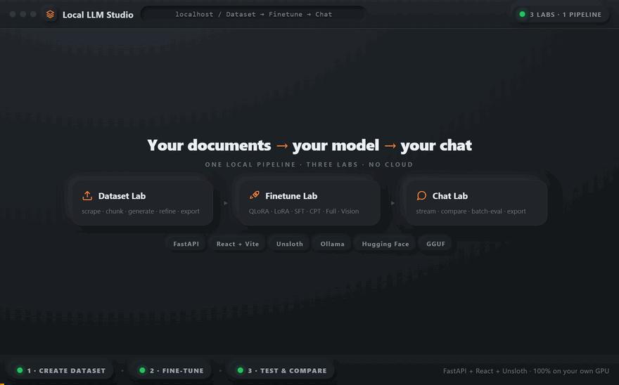
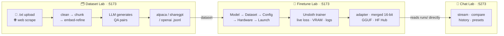

<div align="center">


# Dataset Lab · Finetune Lab · Chat Lab

### Your documents → your model → your chat.

**A three-app local studio for the whole fine-tuning loop: build the dataset, train the model, then actually test it — on your own machine, on your own GPU, with no cloud in the path.**

[](https://www.python.org/downloads/)
[](https://nodejs.org/)
[](https://fastapi.tiangolo.com/)
[](https://react.dev/)
[](https://github.com/unslothai/unsloth)
[](#-license)

<br>



<sub>↑ The three labs, end to end. Source: [`docs/demo/demo.html`](docs/demo/demo.html) — a deterministic, frame-addressable animation rendered to GIF by [`docs/demo/render_demo.py`](docs/demo/render_demo.py).</sub>

<br>

[Why](#-why) • [The three labs](#-the-three-labs) • [Quick start](#-quick-start) • [Dataset Lab](#1--dataset-lab) • [Finetune Lab](#2--finetune-lab) • [Chat Lab](#3--chat-lab) • [API](#-api-reference) • [Troubleshooting](#-troubleshooting)

</div>

---

## ✨ Why

Fine-tuning a model on your own material normally means stitching together four different worlds: a scraper, a chunking script, a training notebook full of CUDA incantations, and some throwaway REPL to see whether the result is any good.

This repo collapses that into **three web apps that hand off to each other**:

| | Lab | What you do | What comes out |
|:--:|:--|:--|:--|
| **1** | **Dataset Lab** | Point it at text or the web. It cleans, chunks, semantically de-duplicates, and has an LLM write instruction/QA pairs. | `alpaca` / `sharegpt` / `openai` JSONL |
| **2** | **Finetune Lab** | Pick a model, drop in that JSONL, choose QLoRA/LoRA/SFT/CPT/Full/Vision, watch loss stream live. | A LoRA adapter, a merged 16-bit checkpoint, or GGUF |
| **3** | **Chat Lab** | Chat with the run you just trained, and put it head-to-head against its own base model. | Proof the training actually landed |

No step uploads your data anywhere. Generation can use a **local Ollama model**; training and inference run on **your GPU**.



---

## 🧭 The three labs

Each lab is a self-contained FastAPI backend + React/Vite frontend, sharing one dark **"control console"** design system (documented in [`skill.md`](skill.md)).

| | Backend | Frontend | Needs a GPU? | Own docs |
|:--|:--|:--|:--|:--|
| **Dataset Lab** | `:8000` | `:5173` | No — Ollama or OpenAI does the generating | [`dataset-lab/README.md`](dataset-lab/README.md) |
| **Finetune Lab** | `:8000` | `:5173` | Yes, to train. The whole UI works without one. | [`finetune-lab/GUIDE.md`](finetune-lab/GUIDE.md) |
| **Chat Lab** | `:8100` | `:5273` | Yes, to load a model. The API boots torch-free. | [`chat-lab/README.md`](chat-lab/README.md) |

> [!IMPORTANT]
> **Dataset Lab and Finetune Lab both default to backend `:8000` and frontend `:5173`.** Run them one at a time, or move one of them (`--port` on uvicorn / `vite --port`, plus `VITE_API_URL` for the frontend). Chat Lab is already out of the way on `:8100`/`:5273`.

---

## 🚀 Quick start

### Dataset Lab — one command

Dataset Lab ships a full installer and CLI runner. This is the only lab with a double-click path.

<table>
<tr><th>Windows</th><th>macOS / Linux</th></tr>
<tr valign="top"><td>

```cmd
git clone https://github.com/amarnath123456789/Dataset-Creator-App.git
cd Dataset-Creator-App
start.bat
```

Or just double-click **`start.bat`**.

</td><td>

```bash
git clone https://github.com/amarnath123456789/Dataset-Creator-App.git
cd Dataset-Creator-App
bash start.sh
```

</td></tr>
</table>

The script runs [`install.py`](install.py) if needed (creates `dataset-lab/.venv`, installs pip + npm deps, writes `.env`), then boots both servers and opens <http://localhost:5173>.

**CLI runner** — [`datasetlab.py`](datasetlab.py):

| Command | Does |
|:--|:--|
| `python datasetlab.py start` | Start backend + frontend |
| `python datasetlab.py stop` | Stop both cleanly |
| `python datasetlab.py status` | Live status + PIDs |
| `python datasetlab.py open` | Open the dashboard |
| `python datasetlab.py logs` | Tail recent server output |

### Finetune Lab

```bash
cd finetune-lab/backend
python -m venv .venv && .venv\Scripts\activate     # Windows
pip install -r requirements.txt
python start_backend.py                            # → :8000

cd ../frontend && npm install && npm run dev        # → :5173
```

> [!WARNING]
> **Plain `pip install -r requirements.txt` silently gives you the CPU-only torch wheel**, even on a machine with an NVIDIA GPU — no error, `torch.cuda.is_available()` just returns `False` and training fails at launch. After installing, note the torch version pip settled on and reinstall it from the CUDA index:
> ```bash
> python -c "import torch; print(torch.__version__)"          # e.g. 2.10.0
> pip install --index-url https://download.pytorch.org/whl/cu126 \
>     torch==<that-version> torchvision --force-reinstall --no-deps
> python -c "import torch; print(torch.cuda.is_available(), torch.__version__)"
> # expect: True 2.x.x+cu126
> ```
> Verified combo: RTX 3070 / driver 591.59 → `torch 2.10.0+cu126`, `bitsandbytes 0.49.2`, `unsloth 2026.6.9`. Full detail in [`finetune-lab/GUIDE.md`](finetune-lab/GUIDE.md#2-install).
>
> **No GPU, just exploring?** `pip install fastapi uvicorn python-multipart pydantic` is enough — the ML stack is imported lazily and only touched at *Launch*.

### Chat Lab

```bash
cd chat-lab/backend
pip install -r requirements.txt     # use the same env as Finetune Lab
python start_backend.py             # → :8100

cd ../frontend && npm install && npm run dev   # → :5273
```

---

## 1 · 🗂 Dataset Lab

**File-based dataset engineering.** Every project is a folder on disk — no database, no hidden state, and a crashed run resumes from exactly where it stopped.

### The pipeline

```
raw.txt → cleaned.txt → chunks.json → qa_v1.json → export_*.jsonl
   clean        chunk       refine        generate       export
```

| Stage | What actually happens |
|:--|:--|
| **Clean** | Normalises whitespace, artefacts and encoding noise out of the raw text |
| **Chunk** | `RecursiveCharacterTextSplitter` with real token counting (`tiktoken` / `cl100k_base`), configurable size + overlap |
| **Refine** | Embeds every chunk with `sentence-transformers` (`all-MiniLM-L6-v2`) and **merges adjacent chunks whose cosine similarity is above the threshold** — kills near-duplicate context before it wastes generation calls |
| **Generate** | Walks the chunks and asks an LLM for instruction/QA pairs, with an editable prompt template, domain hint and QA-density factor |
| **Export** | Renders `qa_v1.json` through a format template into training-ready JSONL |

**Resumable and stoppable by design.** State lives in flag files (`.running`, `.stop`), progress in `progress.json`, and partial output in `qa_partial.json`. Hit *Stop* mid-run and the pairs generated so far survive; hit *Resume* and it picks up at the chunk it left off, skipping clean/chunk/refine entirely.

### Ingestion

- **Upload** — UTF-8 `.txt` files.
- **Web scraping** — a full crawler in its own dashboard: DuckDuckGo search or a URL list, crawl depth, page cap, domain restriction, relevance scoring/threshold, `robots.txt` respect and rate limiting. It runs readability-based article extraction, downloads images with size/format filtering, drops exact and near-duplicates by hash, **auto-labels** each page with an LLM (labels, category, language, summary), and can run a second LLM refinement pass over the scraped text.

### Generation backends

| Provider | Notes |
|:--|:--|
| **Ollama (local)** | Auto-detected at `http://localhost:11434`; the UI lists your pulled models. Free, offline, private. |
| **OpenAI** | Key from the Settings panel or `OPENAI_API_KEY` in `.env`. |

### Export formats

`alpaca` · `sharegpt` · `openai` — driven by [`dataset-lab/backend/formats/formats.json`](dataset-lab/backend/formats/formats.json), so adding a format is a JSON template, not code.

<details>
<summary><b>Configuration (<code>.env</code>, written by the installer)</b></summary>

```env
DEFAULT_CHUNK_SIZE=800
DEFAULT_CHUNK_OVERLAP=100
DEFAULT_SIMILARITY_THRESHOLD=0.92

OPENAI_API_KEY=your_openai_api_key_here
```
</details>

<details>
<summary><b>Screenshots</b></summary>
<br>
<div align="center">
  
  
  
  
  
  
</div>
</details>

---

## 2 · 🚀 Finetune Lab

**No-code local fine-tuning.** A five-step wizard between you and a trained adapter — you never write a training script.

```
Model → Dataset → Config → Hardware → Review → Launch → Monitor → Export
```

### Training methods

All six run **single- or multi-GPU** (DDP via `accelerate`), on the canonical Unsloth runner with OOM auto-retry:

| Method | For |
|:--|:--|
| **QLoRA** | 4-bit base + LoRA adapter — the cheapest way to train an 8B on 8 GB |
| **LoRA** | 16-bit base + adapter |
| **SFT** | Supervised fine-tuning on instruction data |
| **CPT** | Continued pre-training on a raw corpus (+ trainable embeddings, separate embedding LR) |
| **Full** | Full-parameter fine-tune |
| **Vision** | VLM fine-tuning, with per-layer control (vision / language / attention / MLP) |

LoftQ, rsLoRA, scheduler/optimizer/warmup/decay/save-steps/seed and every method-specific flag are exposed in the UI and flow straight through to the engine.

### Models

Three sources: the **curated registry**, any **Hugging Face** repo id, or a **local path** on the training box. The registry ships:

| Model | Params | Ctx | Min VRAM | Methods |
|:--|:--|:--|:--|:--|
| Llama 3 8B Instruct | 8B | 8k | 6 GB | SFT · LoRA · QLoRA · CPT · Full |
| Mistral 7B v0.3 | 7B | 32k | 6 GB | SFT · LoRA · QLoRA · CPT · Full |
| Qwen 2.5 3B | 3B | 32k | 4 GB | SFT · LoRA · QLoRA · CPT · Full |
| Gemma 2 9B IT | 9B | 8k | 8 GB | SFT · LoRA · QLoRA · CPT · Full |
| Phi-3 Mini 4K | 3.8B | 4k | 4 GB | SFT · LoRA · QLoRA · CPT · Full |
| Llama 3.2 11B Vision | 11B | 8k | 10 GB | Vision |
| Qwen2-VL 7B | 7B | 32k | 7 GB | Vision |

The Config step only offers the methods the chosen model supports.

### Datasets

Upload `.jsonl` / `.json` / `.csv` and the backend **auto-detects the schema** and row count:

| Schema | Shape |
|:--|:--|
| Instruction | `{"instruction", "input", "output"}` |
| ChatML | `{"messages": [{"role", "content"}]}` |
| ShareGPT | `{"conversations": [...]}` |
| Completion / CPT | `{"text": "..."}` |

Preference data (`chosen`/`rejected`) is flagged DPO-only and blocked for SFT. Hugging Face dataset ids work too, and are **required for Vision** (image datasets — e.g. `unsloth/LaTeX_OCR`).

### Live monitoring

The Run Dashboard streams **status, loss value *and* loss curve, step/epoch, VRAM, tok/s, ETA, and a live log terminal**. *Smart Config* pre-fills sane hyperparameters from the model size; the Hardware step reads your CUDA devices and gives a VRAM/time estimate with an OOM guard. **Stop** cancels cooperatively and still saves a partial adapter.

### Export

| Target | Notes |
|:--|:--|
| **Adapter** | Copy the LoRA adapter — instant, no GPU |
| **Merged 16-bit** | Base + adapter into a standalone checkpoint |
| **GGUF** | llama.cpp / Ollama format |
| **Push to Hub** | Upload the merged model to Hugging Face |

Artifacts land in `finetune-lab/backend/storage/runs/<run_id>/final/`; export jobs are tracked on the Exports page.

<details>
<summary><b>GPU validation harness</b></summary>

Finetune Lab ships a harness that drives the *real* `run_service → gpu_worker → runner` path for every method on a tiny model and a few steps, asserting completion, true step-based progress, live loss and saved artifacts:

```bash
python -m validation.gpu_validate selftest      # torch-free, passes off-GPU today
python -m validation.gpu_validate preflight
python -m validation.gpu_validate run --all     # run this on the GPU box
```

See [`finetune-lab/backend/validation/README.md`](finetune-lab/backend/validation/README.md).
</details>

---

## 3 · 💬 Chat Lab

**Where you find out whether the training worked.** Chat Lab trains nothing — it reads Finetune Lab's output directly, so a completed run shows up in the model picker with no export step.

| Finetune Lab writes | Chat Lab reads |
|:--|:--|
| `runs/{id}/final/` (adapter + tokenizer) | loads it for inference |
| `runs/{id}/run_manifest.json` | base model, quantization, context length |
| `storage/jobs.json` | which runs are `completed` |
| `model_registry/models.json` | base models to chat with / compare against |

### What it does

- **Chat** — multi-turn, token-streaming conversation with any fine-tuned run or base model. Live system-prompt editor, full generation controls, stop and regenerate.
- **Compare** — same prompt, two models, side by side. One click sets up **base vs fine-tuned** (*did my training change anything?*), or pit two checkpoints against each other.
- **History** — save, reopen, and export conversations to Markdown.
- **Presets** — batch a fixed set of prompts through a model for repeatable sanity checks.

Every response reports **tokens, tokens/sec, and time-to-first-token**.

### How the streaming works

Unsloth `FastLanguageModel` loads the saved adapter directory directly (resolving the base model from `adapter_config.json`); a **transformers + PEFT** path is the automatic fallback. Tokens stream from a `TextIteratorStreamer` running `model.generate` on a background thread, relayed to the browser over **SSE**, and cancelled mid-flight by a `threading.Event` set on `/stop` or on browser disconnect.

Chat Lab always applies each model's **own** tokenizer chat template (`apply_chat_template`, `add_generation_prompt=True`) and trims the oldest turns to fit the context window.

**Defaults:** `temperature 0.7 · top_p 0.9 · top_k 20 · repetition_penalty 1.1 · max_new_tokens 512` (all adjustable per chat; `temperature 0` → greedy).

> All torch/unsloth/transformers imports are deferred, so the API boots and lists models even on a machine with no GPU — loading one then returns a clear, actionable error instead of a stack trace at import time.

---

## 💻 Requirements

| | Details |
|:--|:--|
| **OS** | Windows 10/11 (primary), macOS, Linux |
| **Python** | 3.10+ (3.10/3.11 recommended — Unsloth support) |
| **Node.js** | 18+ |
| **GPU** | NVIDIA + CUDA, required only to *train* and to *load a model in Chat Lab*. Dataset Lab, the wizards, estimates and run history all work without one. |
| **RAM** | 8 GB min · 16 GB+ with local LLMs |
| **Disk** | ~2 GB for the apps, plus 4–10 GB per model |
| **Ollama** | Optional — enables 100% offline dataset generation ([ollama.com](https://ollama.com/download)) |

---

## 📡 API reference

<details>
<summary><b>Dataset Lab — <code>:8000</code></b> · docs at <code>/docs</code></summary>

| Method | Path | Purpose |
|:--|:--|:--|
| `GET`/`POST` | `/projects/` | List / create projects |
| `DELETE` | `/projects/{name}` | Delete a project |
| `POST` | `/projects/{name}/upload` | Upload raw text |
| `POST` | `/projects/{name}/run` | Start the pipeline (supports `resume`) |
| `POST` | `/projects/{name}/stop` | Signal a cooperative stop |
| `GET` | `/projects/{name}/status` | File-based state, counts, progress |
| `GET` | `/projects/{name}/data/{cleaned\|chunks\|qa}` | Inspect each stage |
| `GET` | `/projects/{name}/export` | Export in a chosen format |
| `GET` | `/llm/ollama/models` | Locally pulled Ollama models |
| `GET`/`POST` | `/prompt/` | Read / update the prompt template |
| `POST` | `/scrape/start` · `/refine` · `/test_refinement` · `/cancel/{id}` | Crawl + LLM refinement |
| `GET` | `/scrape/status/{id}` · `/preview/{project}` · `/download/{project}` · `/image/{project}/{name}` | Scrape results |

</details>

<details>
<summary><b>Finetune Lab — <code>:8000</code></b> · docs at <code>/docs</code></summary>

| Method | Path | Purpose |
|:--|:--|:--|
| `POST` | `/api/training/create` | Launch a run |
| `GET` | `/api/training/status/{job_id}` | Live status, loss, logs |
| `GET` | `/api/training/runs` · `/runs/{id}` · `/runs/{id}/checkpoints` | Run history |
| `POST`/`DELETE` | `/api/training/stop/{id}` · `/runs/{id}` | Cancel / delete |
| `GET` | `/api/models/` · `/search/hf` · `/{model_id}` | Registry + HF search |
| `POST` | `/api/models/upload` | Register a local model |
| `GET`/`POST` | `/api/datasets/` · `/upload` · `/validate` · `/search/hf` | Dataset intake + schema detection |
| `POST`/`GET` | `/api/export/create` · `/status/{id}` · `/run/{id}` · `/list` · `/hf` · `/gguf` | Export jobs |
| `GET` | `/api/hardware/gpus` | Detected CUDA devices |

</details>

<details>
<summary><b>Chat Lab — <code>:8100</code></b> · docs at <code>/docs</code></summary>

| Method | Path | Purpose |
|:--|:--|:--|
| `GET` | `/api/models/finetuned` | Runs with loadable weights on disk |
| `GET` | `/api/models/base` | Base models from the Finetune Lab registry |
| `GET` | `/api/models/status` | Resident models, GPU/VRAM snapshot, torch availability |
| `POST` | `/api/models/load` · `/unload` | Warm / free a model |
| `POST` | `/api/chat/stream` | SSE reply (`meta`/`ready`/`start`/`token`/`done`/`error`) |
| `POST` | `/api/chat/stop` | Cancel an active stream |
| `POST` | `/api/chat/compare` | One reply per target for the same prompt |
| `GET`/`POST`/`DELETE` | `/api/conversations[...]` | CRUD + `/{id}/export.md` |

</details>

---

## 📁 Repository layout

```text
Dataset-Creator-App/
├── install.py              ← Dataset Lab one-command installer
├── datasetlab.py           ← Dataset Lab CLI (start/stop/status/open/logs)
├── start.bat / start.sh    ← double-click / shell starters
├── skill.md                ← the shared "control console" UI design system
├── docs/demo/              ← the animated demo above (demo.html + render_demo.py → demo.gif)
│
├── dataset-lab/
│   ├── backend/            ← FastAPI: engines/ (chunking, cleaning, embedding_refiner,
│   │                          generation, exporter, scraping/, processing/, labeling/),
│   │                          llm/ (local, openai), routes/, formats/, prompts/
│   ├── frontend/           ← React 19 + Vite + Tailwind (Dashboard, Workspace, Scraping)
│   ├── projects/           ← generated: one folder of files per project
│   └── .venv / .logs / .env   ← created by the installer / on start
│
├── finetune-lab/
│   ├── backend/            ← FastAPI: api/, core/ (training_engine, model_engine,
│   │                          dataset_engine, hardware_engine), training/ (Unsloth runners),
│   │                          job_engine/, workers/, validation/, model_registry/
│   ├── frontend/           ← wizard + run dashboard + loss chart
│   └── backend/storage/    ← datasets/ · runs/<id>/final/ · exports/ · jobs.json
│
└── chat-lab/
    ├── backend/            ← FastAPI: api/, engine/ (model_manager, inference,
    │                          chat_format), services/ (run_registry, conversation_store)
    └── frontend/           ← Chat · Compare · History · Presets
```

---

## 🚑 Troubleshooting

| Symptom | Cause | Fix |
|:--|:--|:--|
| Port `8000` / `5173` already in use | Dataset Lab and Finetune Lab share both defaults | Run one at a time, or repoint one (`--port`, `vite --port`, `VITE_API_URL`) |
| Dataset Lab pipeline stuck in "Running" | Server died mid-run, lock file survived | Delete `.running` / `.stop` in `dataset-lab/projects/<project>/` |
| Can't reach Ollama | Service not running | `ollama run llama3`, then check `http://localhost:11434` |
| `torch.cuda.is_available()` is `False` **with** an NVIDIA GPU | CPU-only torch wheel — not a driver problem | `nvidia-smi` confirms the driver; `pip show torch` with no `+cuXXX` suffix confirms the wheel. Reinstall from the CUDA index (see [Finetune Lab quick start](#finetune-lab)) |
| Launch → run immediately `failed`, log mentions `unsloth`/`torch` | ML stack missing in the backend's env | Install torch (CUDA) + unsloth on the GPU box |
| OOM during training | Batch/seq too large | The runner auto-retries lighter (visible in the log); or lower batch/seq, or switch to QLoRA 4-bit |
| Hardware step shows "Reference GPUs" | No CUDA device detected | Expected — estimates still work, training needs a real GPU |
| Multi-GPU run won't launch | Needs `accelerate` + >1 CUDA device | Single-GPU always works |
| `Form data requires "python-multipart"` on boot | Wrong interpreter | `pip install python-multipart` |
| `ModuleNotFoundError` / `npm error` in Dataset Lab | Deps drifted | `python install.py` again |
| Frontend loads, every call fails / CORS | Backend down or on another host | Start it, or set `VITE_API_URL` |

Dataset Lab crashed and you want to know why: `python datasetlab.py logs`.

---

## 📊 Status

| Lab | State |
|:--|:--|
| **Dataset Lab** | **Stable.** Full pipeline, resume/stop, scraping dashboard, three export formats. |
| **Finetune Lab** | **Feature-complete, GPU validation in progress.** All six methods implemented end-to-end on the canonical Unsloth runner with real step-based progress, live loss/VRAM/ETA and streaming logs; verified off-GPU (torch-free API boot, route table, event→record translation, schema detection, config mapping). Remaining: validating real GPU runs — especially multi-GPU and Vision — via `backend/validation/`. |
| **Chat Lab** | **v1, verified off-GPU.** API boots torch-free; routes, model discovery and conversation CRUD tested; frontend builds and lints clean. Remaining: a real GPU chat/compare pass on a machine with the training stack. |

Roadmaps: [`finetune-lab/ROADMAP.md`](finetune-lab/ROADMAP.md) · [`dataset-lab/FUTURE_ENHANCEMENTS.md`](dataset-lab/FUTURE_ENHANCEMENTS.md)

---

## 🎨 Design system

All three frontends share one **dark skeuomorphic "control console"** language — a fixed top-left light source, true-black drop shadows, recessed troughs, glowing orange LEDs and terminal-green log surfaces. The complete kit (Tailwind config, CSS variables, shadow physics, component dictionary) is in [`skill.md`](skill.md), written so it can be dropped into another project wholesale.

### Rebuilding the demo GIF

```bash
python docs/demo/render_demo.py            # → docs/demo/demo.gif
```

[`demo.html`](docs/demo/demo.html) renders frame `N` deterministically from `?f=N`, so the capture is reproducible; the script drives headless Chrome once per frame at 2× scale, downsamples with Lanczos, and encodes a single-global-palette GIF that diff-compresses to ~1 MB. Open it without the query string to watch it autoplay in a browser.

---

## 🤝 Contributing

1. Fork, then branch: `git checkout -b feature/awesome-thing`
2. Match the existing style — backends are FastAPI + Pydantic, frontends are React 19 + Tailwind against the `skill.md` component set.
3. Commit with clear messages, push, and open a PR describing *what* changed and *why*.

Found a bug? [Open an issue](https://github.com/amarnath123456789/Dataset-Creator-App/issues).

## 📄 License

MIT.

<div align="center">
<br>
<sub><b>Dataset Lab → Finetune Lab → Chat Lab.</b> Your documents, your model, your chat — all of it local.</sub>
</div>
